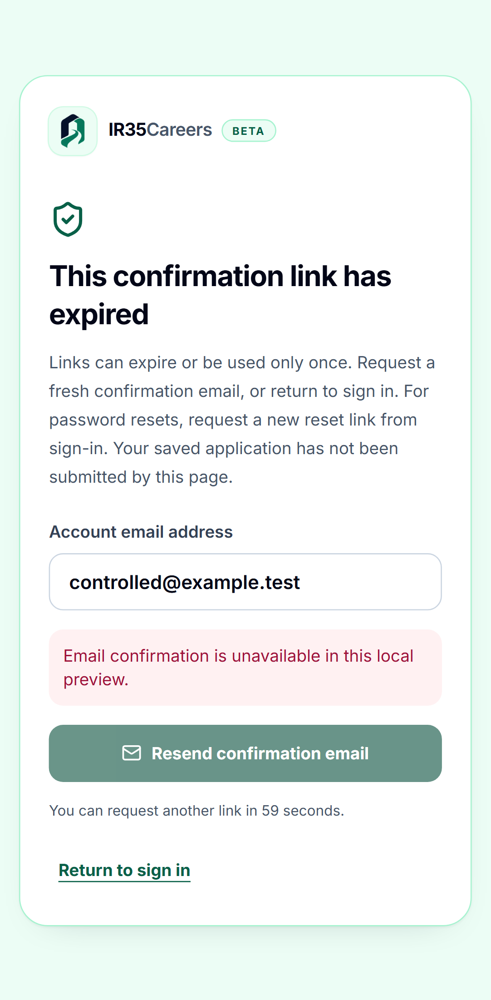
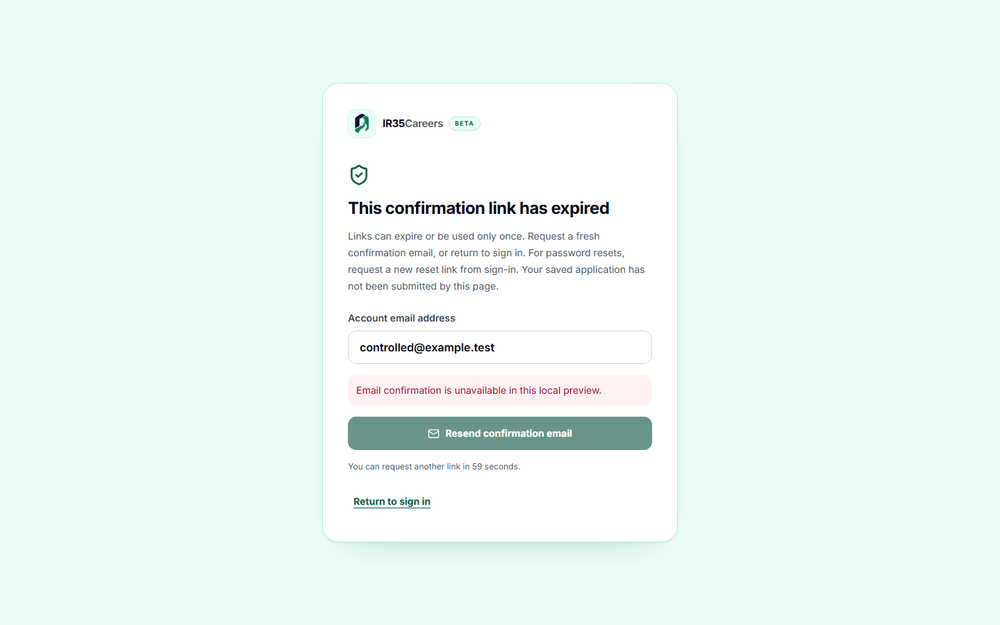

# P0.9 — canonical confirmation and saved application context

## What / why

Implement the missing www callback/recovery, explicit confirmation resend, confirmed-email application boundary and job-aware sign-in. Fix no-CV Apply settings deep links. Keep admin OAuth and GitHub import separate; preserve approval/lifecycle/tenant checks. See `incident-auth.md` for findings and evidence limits.

## Verification

- Unit: canonical payloads/safe redirects, fixed expiry errors, SDK initialization and independently verified identity, phone/metadata rejection, manual/internal/scheduled endpoint rejection before database access. Actual installed SDK runs against isolated implicit/PKCE mock transport, never a live token.
- Worker claim rechecks confirmation for old queued/changed identities; unconfirmed preflight returns needs-user without CV/portal payload or a browser call. Existing approval checks still run for confirmed accounts.
- Browser: phone/tablet/desktop journeys for expired recovery/context preservation, unsafe redirect/spoofed job facts, and Apply settings without a CV. Production-mode preview clears production Supabase credentials. Axe serious/critical checks remain. Final results/screenshots recorded after verification.
- Full type/lint/Vitest/199 legacy/build/security checks and final-head CI required before merge. Two existing exact advisory exceptions expire 29 October; no new exception.

## Data / environment / release

Final local results: **675 unit tests/124 files + 199 legacy checks, strict types/lint, isolated production build, all nine browser cases, 53 focused checks** pass. Actual SDK implicit/PKCE cases and execution-time preflight are included. Scoped Axe scans have no serious/critical violation; no new skip/baseline/exemption. The first browser run's route-announcer selector was scoped to `main`, then all nine passed together. Source/history scan (646 source files) and bounded dependency audit pass; final-head CI remains required.

Reviewed fictional captures (preview deliberately cannot send confirmation emails):

No migration or new environment variable. No RLS/CSP relaxation, billing/DNS/auth setting change or real employer submission. Existing **025** / compatible rolling-client release gate and Vercel deployment hold remain. Merge is not production deployment; runner flags stay unchanged until **YES CUTOVER**.

## Manual account dependencies (agent executes where available)

1. Supabase canonical www Site URL and callback/query allowlist; preserve admin/GitHub destinations. Verify templates honour RedirectTo/ConfirmationURL. Do not dump provider secrets.
2. Supabase rejects custom-domain inspection with `entitlement_required`; Pro + paid add-on is needed. Owner hostname/paid approval pending. Before activation, add each OAuth provider's new `/auth/v1/callback` while retaining its old callback; confirm DNS/TLS and Google consent branding. This PR does not configure a domain.
3. After compatible release, use only `anvesh.mannuru+ir35test@gmail.com` and mock ATS: latest confirmation once, safe job return, explicit expiry resend, unconfirmed rejection, Google customer/admin routing, Apply settings before CV upload. Never test against a real employer.
4. Vercel/DNS/Google changes above remain external gates. No Stripe/mail transport configuration change is included.
