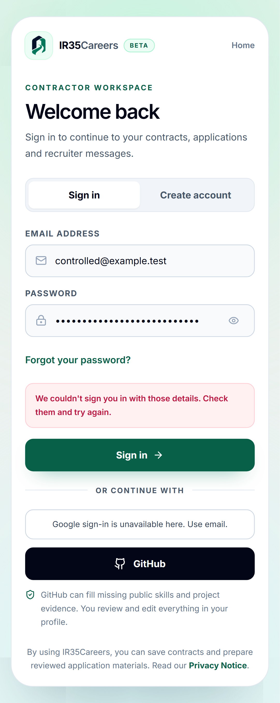
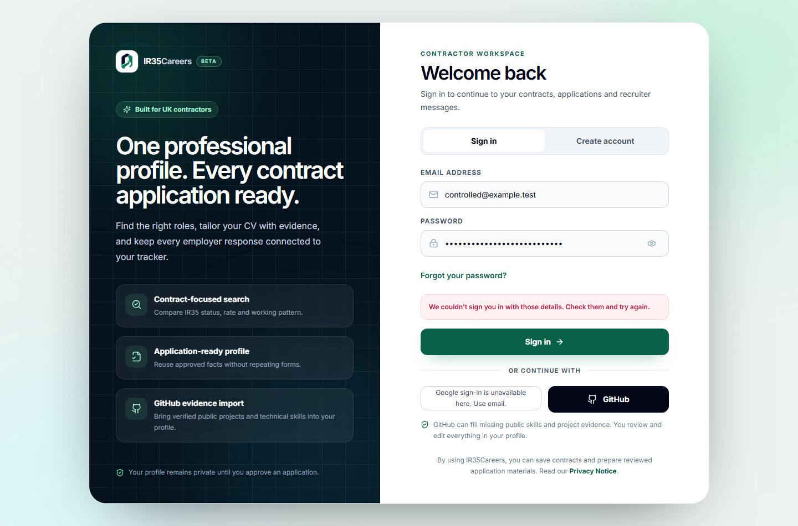

# P0.9a — free, nonce-bound Google sign-in

## What / why

Replace the customer/admin Google redirect entry with Google's rendered GIS button and Supabase `signInWithIdToken`, without the paid Supabase custom-domain add-on. Keep the default domain and explicit flag-protected redirect fallback. The owner requested zero budget; no subscription, paid add-on, DNS, worker deployment or cutover is part of this change.

Each attempt uses 32 random bytes, sends their SHA256 hex hash to Google, and supplies the original nonce to Supabase once. Attempts expire after five minutes and are discarded on cleanup. Local bounded token claims are only intent checks; Supabase still verifies signatures/nonce. No token/nonce is logged, persisted by this code or placed in a URL. Errors are fixed safe copy. Account return uses existing allowlists; administrator membership remains server-verified. GitHub linking/import is unchanged.

## CSP / privacy

Only account/admin sign-in routes add `https://accounts.google.com/gsi/client` for script, `/gsi/style` for stylesheet and `/gsi/` for connect/frame. This is the narrow change documented by Google for GIS, not a wildcard or global frame relaxation. Request nonces, strict-dynamic, no inline scripts, RLS and private-data boundaries remain. The account passes its request nonce to Next Script. No automatic One Tap, account auto-selection or credential request occurs; create-account mode requires terms consent before loading GIS. Existing popup COOP is retained.

## Tests and screenshots

Unit tests cover cryptographic hashing/randomness, one-use/expired/discarded attempts, wrong nonce/audience/issuer/expiry, malformed credentials, exact original-nonce Supabase payload, fixed failures, fallback off/on and route-scoped CSP. Existing canonical confirmation/admin/GitHub tests remain.

Production-mode phone/tablet/desktop tests deliberately clear real Supabase/Google settings: they prove honest unavailable state, no Google/auth request, no implicit redirect, consent gating, direct fallback rejection and accessible email recovery. They do **not** prove actual Google account/branding success. The first run found a genuine ARIA role error and the component was fixed without weakening Axe assertions. A fresh production build and all **15 cases** then passed together (six new Google boundary cases plus nine existing auth cases). Scoped Axe scans pass with no serious/critical issue, no new skip/exemption/baseline change.

Reviewed fictional offline captures (no actual provider credentials):

Final local release verification: **713 unit tests/126 files, 199 legacy checks, TypeScript and ESLint pass**. Source/history scanning passes (657 tracked files). The dependency gate passes only with the two existing owner-approved exact advisory/version exceptions until 29 October; no new exception or claim of zero advisories. Final-head CI and the real configured-preview test remain open.

## Environment / migration / manual steps

- Public names: `NEXT_PUBLIC_GOOGLE_CLIENT_ID`, `NEXT_PUBLIC_GOOGLE_REDIRECT_FALLBACK_ENABLED` (default false). The ID is not the OAuth secret. Both require a build when changed.
- No SQL migration or service-role/RLS change. Migration 025 and compatible workspace release remain separate prerequisites; do not release this whole branch against customer data before those gates.
- Exact Google Cloud Branding/Clients/Audience and Supabase Google nonce settings: `google-identity-setup.md`. Use only existing free configuration. Add the actual controlled preview origin, not a guessed or wildcard URL. Never skip provider nonce checks.
- Vercel Git holds remain on main/preparation branches. No hosted preview was created; check free allowance and configure only the required public ID/isolated test access before deliberately deploying.
- Use only the approved test identity (`anvesh.mannuru+ir35test@gmail.com`; confirm its underlying Google identity if Google removes the plus suffix) on preview before production. Verify actual GIS/CSP, displayed brand/domain, expected Supabase user, saved-job return, admin authorization and flagged fallback. Never capture live tokens in traces or submit to a real employer.

## Rollback / release gate

No production rollout in this PR. If a later approved GIS rollout fails, the old redirect can be deliberately enabled with the public fallback flag and rebuilt, keeping provider callbacks intact. Do not automatically send users through it or claim branded consent. `APPLY_RUNNER` and `APPLICATION_WORKER_ACCEPT_JOBS` are unchanged and remain gated on literal **YES CUTOVER**. Oracle signup is still waiting for the owner; Railway remains empty and undeployed.
